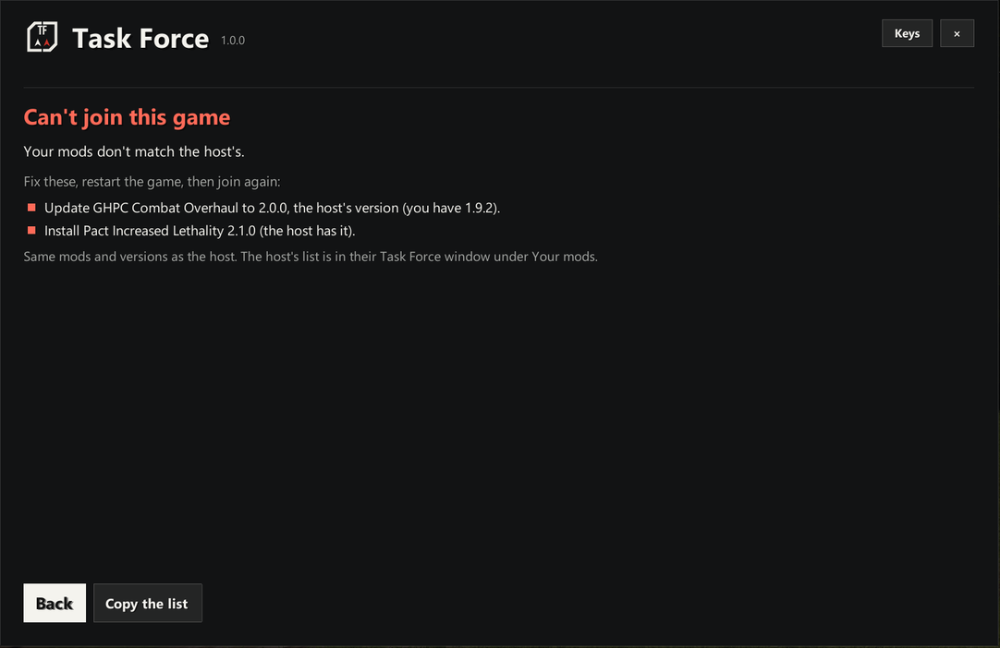

**English** · [Русский](README.ru.md) · [简体中文](README.zh-CN.md)

# Task Force

**Multiplayer mod for *Gunner, HEAT, PC!*, over Steam.**

Play the game's own missions and Phase Line ones together. Multicrew tanks, or fight in PVP battles with capture zones - your choice!

Integrated with PhaseLine custom missions, steam invites, public lobby system, voice chat, automated mod check, safeguards, and many more!

(PvP and multicrew are currently in testing stage - not in release)

**[Download](../../releases/latest)** · [Install](#install) · [Host](#hosting) · [Join](#joining) · [Keys](#keys) · [Bug reports](#something-broke)

**[Join the unofficial GHPC modding Discord](https://discord.gg/BW2sgyCht7)**: updates, WIPs, other mod releases, and a place to chat with modders and the whole community.

---

I wanted to play GHPC with a friend, in the missions we both already know, without setting up a server. So: you press F7, host, send a code, and you're in the same battle.

Up to 4 players is what I've tested. 6 and 8 are in the list if you want to try, but expect trouble, and tell me how it went.

## Install

**You need:** *Gunner, HEAT, PC!* build 20261014 on Steam and MelonLoader 0.7.x.

1. Install MelonLoader with the [MelonLoader installer](https://github.com/LavaGang/MelonLoader.Installer) and start the game once.
2. Download `GHPCCoop.dll` from [Releases](../../releases/latest) and put it in `Bin\Mods` (Steam > GHPC > right-click > Manage > Browse local files > Bin > Mods).
3. Start the game and press **F7** in the main menu.

Everyone needs the same version of Task Force. Combat Overhaul and Phase Line are optional, but if the host has them, you need them too.

## Hosting

1. **Press F7 > Host. Or open Task Force tab.** Pick who can join: friends, anyone with the code, or everyone (then your game shows in the list).
2. Invite from the line under the player list (it opens the Steam overlay) or give people the six-letter code. Click the code to copy it.
3. **Change mission** picks one. Phase Line missions are sent to the others by themselves. Their row shows the download.
4. Set it up on the **Settings** page.
5. Wait for READY on every row, then **Start**.

On the planning map everyone presses the game's Start mission. A short countdown starts you together.

During the mission, F7 is the player table: who's in, what they're doing, kills, assists, deaths, ping. The host restarts or goes back to the lobby from there. Both count down 5 seconds on every PC, and pressing again calls it off.

## Joining

Accept the Steam invite, pick a game from the list, or **F7 > type the code > Join**.

If your mods don't match the host's, the window lists exactly what to install, update or remove. Fix that, restart the game, join again.

**Direct IP** (LAN, VPN): F7 > Advanced. The host picks "Host by IP instead", you type their address. Port 27760 UDP. Windows may ask to let the game through the firewall.

## Settings

The host sets these in the lobby. The chips on the mission card show what's set.

| | |
|---|---|
| **Difficulty** | **Arcade:** enemy markers, enemies on the map and aim help are allowed, nobody is forced to use them. **Realistic:** none of those. **Simulator:** sights and commander's view only, allies' names only up close, no hit cam or death cam, no free camera while your tank still fights. |
| **Time of day** | Night loads the mission's own night version if it has one. |
| **Weather** | The host's sky for everyone. |
| **Radio** | Realistic, Simple or Off. Simple by default. The sound pack (Military, Walkie-talkie, Satcom or off) is each player's own, under Mic. |
| **Fire support** | Shared or each their own, how many calls, how fast the battery reloads. |
| **Time limit** | Off, or a clock for the mission. Not done by then, the mission is lost. |
| **Vehicles** | "The mission's" or "Everyone picks". Then each player picks with the button on their row. |
| **Zeus** | For the host, in Phase Line missions. |
| **Players** | 2, 3, 4, 6 or 8, picked on the Host page before you host. Above 4 is untested. |

While you're in someone's game you play on the host's settings for the gameplay mods you both have. Yours come back when you leave. If the game crashes, you're asked on the next start.

## What's shared

The host's PC decides, everyone else sees the same thing:

- Every unit: vehicles, soldiers, helicopters, planes, emplacements. Where they are, what they shoot, when they die.
- Your own shots land where you saw them land.
- Guided missiles, crew bailing out, wrecks and fires.
- Reinforcements and anything else that turns up mid-mission.
- Objectives, mission events and the result.
- Artillery and air support. Your call goes to the host's guns.
- Time of day and weather.
- Phase Line triggers, and Zeus for the host.
- Who knocked out what, on the end panel.

And between players:

- **Chat** and **push to talk** on a team radio.
- **Pings** and an **orders wheel**: move here, attack, hold, regroup on me, danger.
- **Towing.** Pull a stuck or knocked-out teammate.
- **Helping with repairs** (with Combat Overhaul): stand next to a teammate who's repairing and it goes faster.
- **Taking over a free tank** when yours is knocked out.
- **Dropping an AT team** from a troop carrier, in Phase Line missions.

No pausing and no slow motion: time is everyone's. If a player leaves, the AI takes their tank. If the host leaves, the mission ends.

**Lost connection?** Your game calls the host back by itself for two minutes and your tank waits for you. **Game crashed?** Start it again and join the same way. You go straight back into the mission.

## Keys

Defaults. Change them in F7 > Keys. A key another mod already uses is pointed out there.

| Key | |
|---|---|
| F7 | The Task Force window. In a mission: the player table, vote someone out, restart. |
| / | Chat. Enter sends, Esc cancels. |
| Middle mouse | Tap: ping where you look. Hold: the orders wheel. |
| `~ (left of 1) | Push to talk | (can be rebound in F7>Keys) - note on realistic setting of radio the range will drop, and two people cannot talk at the same time! this is **intended**. Use simple mode for basic voice chat.
| Alt+Y | Tow cable. Near a teammate, both press it and the one in front tows. Near a knocked-out tank of your side, one press. Again to unhook. |
| K | Help a teammate who's repairing (Combat Overhaul's repair key) |
| Alt+T | Knocked out? Take over a free tank on your side. |
| Alt+D | In a stopped troop carrier, Phase Line missions: drop your AT team. Click to place, wheel switches, right-click cancels. |

## Mods that must match

| | |
|---|---|
| **Must match the host, same version** | Task Force itself. Gameplay mods: vehicle mods, Pact Increased Lethality, Fulda 1989, Combat Overhaul, or other gameplay-changing mods. |
| **Recommended** | Visual mods. Phase Line: you need it when the host picks a Phase Line mission. |
| **Yours, nobody checks** | UI mods. |

You don't need the host's Phase Line missions beforehand. The host's mission lands in your Phase Line missions folder as `<mission> (from <host>)`. Only mission data files are ever sent.

## Known gaps

- No joining a mission that's already running, only getting back in after a drop. Join in the lobby.
- If the host leaves, the mission is over for everyone.
- More than 4 players is untested.
- PvP isn't in this version. The lobby says "PvP: coming soon" and means it. Although it is in very advanced stage and should come.. sooner than you think :)
- After a rejoin, your mission clock starts again from zero. The host's clock is the one that counts.
- A game update can break it until the mod is updated.

## Something broke?

Open an issue and say what you were doing. Attach two files from the game's `Bin` folder:

- `MelonLoader\Latest.log`
- the newest `UserData\GHPCCoop\logs\coop-....log` (one per game)

If you can, get the same two from **every player** who was in. Most co-op bugs only make sense with both sides.

## Credits

- Radian Simulations, for the game. Task Force isn't made or endorsed by them.
- Everyone who spent evenings in the test builds.

## License

Closed source. All rights reserved. Free to download and play, please don't re-upload it elsewhere.

*Gunner, HEAT, PC!* belongs to Radian Simulations.
