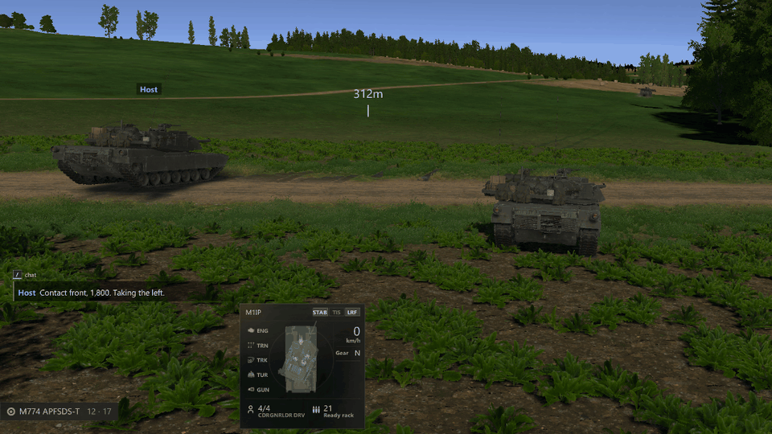

[English](README.md) · **Русский** · [简体中文](README.zh-CN.md)

# Task Force

**Мультиплеер-мод для *Gunner, HEAT, PC!* через Steam.**

Играйте вместе в миссии самой игры и в миссии Phase Line. Многоместные экипажи или PvP-бои с зонами захвата - выбирай сам!

Интеграция с миссиями Phase Line, приглашения Steam, публичные лобби, голосовой чат, автоматическая проверка модов, защита и многое другое!

(PvP и многоместные экипажи пока в тестировании - не в этом релизе)

**[Скачать](../../releases/latest)** · [Установка](#установка) · [Создать игру](#создать-игру) · [Зайти](#зайти-в-игру) · [Клавиши](#клавиши) · [Баг-репорты](#что-то-сломалось)

**[Заходи в неофициальный Discord по моддингу GHPC](https://discord.gg/BW2sgyCht7)**: обновления, WIP, релизы других модов и общение с моддерами и всем сообществом.

---

Я хотел поиграть в GHPC с другом, в миссиях, которые мы оба и так знаем, и без возни с сервером. Поэтому так: жмёшь F7, создаёшь игру, отправляешь код, и вы в одном бою.

Я проверял до 4 игроков. 6 и 8 в списке тоже есть, если хочешь попробовать, но жди проблем и расскажи, как прошло.

## Установка

**Нужно:** *Gunner, HEAT, PC!* сборка 20261014 в Steam и MelonLoader 0.7.x.

1. Поставь MelonLoader через [установщик MelonLoader](https://github.com/LavaGang/MelonLoader.Installer) и запусти игру один раз.
2. Скачай `GHPCCoop.dll` из [Releases](../../releases/latest) и положи в `Bin\Mods` (Steam > GHPC > правый клик > Управление > Просмотреть локальные файлы > Bin > Mods).
3. Запусти игру и нажми **F7** в главном меню.

Версия Task Force у всех должна быть одна и та же. Combat Overhaul и Phase Line не обязательны, но если они есть у хоста, они нужны и тебе.

## Создать игру

1. **F7 > «Хост».** Выбери, кто может зайти: «Друзья», «По коду» или «Все» (тогда твоя игра видна в списке).
2. Пригласи через строку под списком игроков (откроется оверлей Steam) или дай людям код из шести знаков. Нажми на код, чтобы его скопировать.
3. Кнопка **«Сменить»** выбирает миссию. Миссии Phase Line отправляются остальным сами, в их строке видно скачивание.
4. Настрой всё на странице **«Настройки»**.
5. Дождись «Готов» в каждой строке и жми **«Старт»**.

На карте планирования все жмут «Начать миссию» самой игры. Короткий отсчёт, и вы стартуете вместе.

Во время миссии F7 открывает таблицу игроков: кто в игре, чем занят, уничтожения, помощь, смерти, пинг. Оттуда хост перезапускает миссию или возвращает всех в лобби. В обоих случаях на каждом ПК идёт отсчёт 5 секунд, а повторное нажатие всё отменяет.

## Зайти в игру

Прими приглашение в Steam, выбери игру из списка или **F7 > введи код > «Зайти»**.

Если твои моды не совпадают с модами хоста, окно точно скажет, что поставить, обновить или удалить. Исправь, перезапусти игру и заходи снова.

**Прямой IP** (LAN, VPN): F7 > «Дополнительно». Хост жмёт «Создать по IP», ты вводишь его адрес. Порт 27760 UDP. Windows может спросить, пускать ли игру через брандмауэр.

## Настройки

Их задаёт хост в лобби. Чипы на карточке миссии показывают, что выбрано.

| | |
|---|---|
| **Сложность** | **«Аркада»:** метки врагов, враги на карте и помощь в прицеливании разрешены, пользоваться ими никто не обязан. **«Реализм»:** ничего из этого. **«Симулятор»:** только прицелы и вид командира, имена союзников только вблизи, без камеры попаданий и камеры гибели, без свободной камеры, пока твой танк ещё в бою. |
| **Время суток** | «Ночь» загружает ночную версию миссии, если она у миссии есть. |
| **Погода** | У всех небо хоста. |
| **Рация** | «Реализм», «Простая» или «Выкл.». По умолчанию «Простая». Звуки рации («Военные», «Уоки-токи», «Спутник» или «Выкл.») каждый выбирает себе сам, в разделе «Микрофон». |
| **Огневая поддержка** | Общие батареи или у каждого свои, сколько вызовов, как быстро батарея перезаряжается. |
| **Лимит времени** | «Нет» или таймер на миссию. Не успели к сроку, миссия проиграна. |
| **Машины** | «Из миссии» или «Выбирает каждый». Во втором случае каждый выбирает машину кнопкой в своей строке. |
| **Zeus** | Для хоста, в миссиях Phase Line. |
| **Игроки** | 2, 3, 4, 6 или 8, выбирается на странице «Хост» до создания игры. Больше 4 не проверялось. |

Пока ты в чужой игре, для геймплейных модов, которые есть у вас обоих, действуют настройки хоста. Твои вернутся, когда выйдешь. Если игра вылетит, при следующем запуске тебя спросят.

## Что у всех общее

Решает ПК хоста, остальные видят ровно то же самое:

- Все юниты: техника, пехота, вертолёты, самолёты, огневые точки. Где они, во что стреляют, когда погибают.
- Твои выстрелы попадают туда, куда ты видел.
- Управляемые ракеты, экипаж, покидающий машину, остовы и пожары.
- Подкрепления и всё остальное, что появляется посреди миссии.
- Задачи, события миссии и её итог.
- Артиллерия и поддержка с воздуха. Твой вызов уходит на орудия хоста.
- Время суток и погода.
- Триггеры Phase Line и Zeus для хоста.
- Кто кого подбил, на итоговой панели.

А между игроками:

- **Чат** и **«нажми и говори»** по рации команды.
- **Метки** и **колесо приказов**: двигаться сюда, атака, держать здесь, собраться ко мне, опасность.
- **Буксировка.** Тяни застрявшего или подбитого товарища.
- **Помощь с ремонтом** (с Combat Overhaul): встань рядом с товарищем, который чинится, и ремонт пойдёт быстрее.
- **Пересадка в свободный танк**, когда твой подбит.
- **Высадка ПТ-расчёта** из транспорта, в миссиях Phase Line.

Без паузы и без замедления: время у всех общее. Если игрок выходит, его танк берёт ИИ. Если выходит хост, миссия заканчивается.

**Потерял связь?** Игра сама две минуты пытается достучаться до хоста, а твой танк тебя ждёт. **Игра вылетела?** Запусти её снова и заходи так же. Попадёшь прямо обратно в миссию.

## Клавиши

Это клавиши по умолчанию. Поменять их можно в F7 > «Клавиши». Если клавишу уже занимает другой мод, там это будет видно.

| Клавиша | |
|---|---|
| F7 | Окно Task Force. В миссии: таблица игроков, голосование за кик, перезапуск. |
| / | Чат. Enter отправляет, Esc отменяет. |
| Средняя кнопка мыши | Нажать: метка туда, куда смотришь. Держать: колесо приказов. |
| ` ~ (слева от 1) | Нажми и говори |
| Alt+Y | Буксирный трос. Рядом с товарищем жмёте оба, тянет тот, кто впереди. Рядом с подбитым танком своей стороны хватит одного нажатия. Ещё раз, чтобы отцепить. |
| K | Помочь товарищу с ремонтом (клавиша ремонта Combat Overhaul) |
| Alt+T | Подбили? Пересядь в свободный танк своей стороны. |
| Alt+D | В стоящем транспорте, в миссиях Phase Line: высадить ПТ-расчёт. Клик ставит, колесо переключает, правый клик отменяет. |

## Моды, которые должны совпадать

| | |
|---|---|
| **Должны совпадать с хостом, та же версия** | Сам Task Force. Геймплейные моды: моды на технику, Pact Increased Lethality, Fulda 1989, Combat Overhaul. |
| **Рекомендуются** | Визуальные моды. Phase Line: нужен, когда хост выбирает миссию Phase Line. |
| **Только твои, никто не проверяет** | Моды интерфейса. |

Миссии Phase Line хоста заранее не нужны. Миссия хоста попадает в твою папку миссий Phase Line как `<mission> (from <host>)`. Пересылаются только файлы данных (сама миссия, её картинки и звуки), код никогда.

## Чего пока нет

- Нельзя зайти в уже идущую миссию, можно только вернуться после обрыва связи. Заходи в лобби.
- Если хост выходит, миссия заканчивается для всех.
- Больше 4 игроков не проверялось.
- PvP в этой версии нет. В лобби написано «PvP: скоро», и это всерьёз.
- После переподключения твои часы миссии идут с нуля. Считаются часы хоста.
- Обновление игры может сломать мод, пока мод не обновится.

## Что-то сломалось?

Открой issue и напиши, что ты делал. Приложи два файла из папки `Bin` игры:

- `MelonLoader\Latest.log`
- самый новый `UserData\GHPCCoop\logs\coop-....log` (по одному на каждую игру)

Если можешь, возьми те же два файла у **каждого игрока**, кто был в игре. Большинство багов кооператива понятны, только когда видно обе стороны.

Имён игроков в `Latest.log` нет. Они есть в логе кооператива.

## Благодарности

- Radian Simulations, за игру. Task Force сделан не ими и ими не одобрен.
- Всем, кто проводил вечера в тестовых сборках 0.3 и присылал логи с обоих ПК.

## Лицензия

Исходники закрыты, в релизах только DLL. Все права защищены. Скачивать и играть можно бесплатно, только не перезаливай его на другие сайты.

*Gunner, HEAT, PC!* и всё, что в ней есть, принадлежит Radian Simulations.
