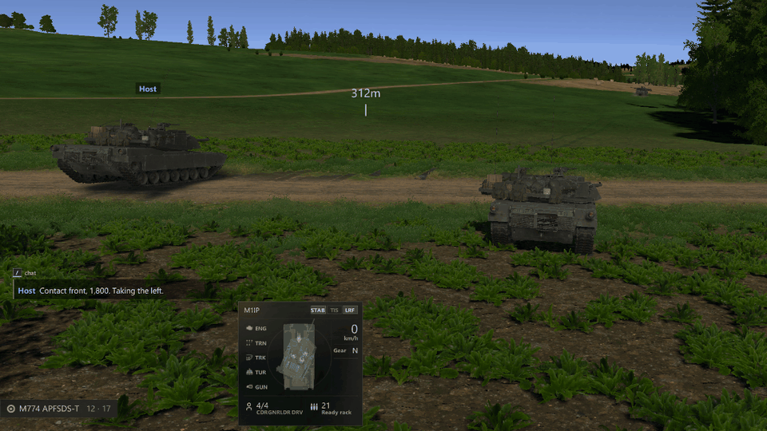

[English](README.md) · [Русский](README.ru.md) · **简体中文**

# Task Force

**通过 Steam 联机的 *Gunner, HEAT, PC!* 多人模组。**

一起玩游戏自带的任务和 Phase Line 任务。多人同车，或者在有占领区的 PvP 战斗里对战——你来选！

整合了 Phase Line 自定义任务、Steam 邀请、公开大厅、语音聊天、自动模组检查、防护措施等等！

（PvP 和多人同车目前还在测试阶段，不在本次发布中）

**[下载](../../releases/latest)** · [安装](#安装) · [创建游戏](#创建游戏) · [加入](#加入游戏) · [按键](#按键) · [反馈 bug](#出问题了)

**[加入非官方 GHPC 模组 Discord](https://discord.gg/BW2sgyCht7)**：更新、开发中的内容、其他模组发布，还能和模组作者以及整个社区聊天。

---

我想和朋友一起玩 GHPC，玩我们都熟悉的任务，又不想折腾服务器。所以就这么简单：按 F7，创建游戏，发个房间码，你们就在同一场战斗里了。

我测试过最多 4 人。列表里也有 6 和 8，想试可以试，但估计会出问题，试完告诉我结果。

## 安装

**需要：** Steam 上的 *Gunner, HEAT, PC!* 版本 20261014，以及 MelonLoader 0.7.x。

1. 用 [MelonLoader 安装器](https://github.com/LavaGang/MelonLoader.Installer)装好 MelonLoader，然后启动一次游戏。
2. 从 [Releases](../../releases/latest) 下载 `GHPCCoop.dll`，放进 `Bin\Mods`（Steam > GHPC > 右键 > 管理 > 浏览本地文件 > Bin > Mods）。
3. 启动游戏，在主菜单按 **F7**。

所有人的 Task Force 版本必须相同。Combat Overhaul 和 Phase Line 是可选的，但如果主机装了，你也得装。

## 创建游戏

1. **F7 > 主机。** 选择谁可以加入：好友、持房间码，或所有人（这样你的游戏会显示在列表里）。
2. 用玩家列表下面那一行发邀请（会打开 Steam 覆盖界面），或者把六位房间码告诉别人。点一下房间码就能复制。
3. 用 **更换任务** 选任务。Phase Line 任务会自动发给其他人，他们那一行会显示下载进度。
4. 在 **设置** 页面里调好。
5. 等每一行都显示“准备”，然后点 **开始**。

在规划地图上，每个人都按游戏自带的“开始任务”。短暂倒计时后，大家一起开始。

任务中，F7 是玩家表：谁在、在做什么、击毁、助攻、阵亡、延迟。主机在这里重开任务或返回大厅。两者都会在每台电脑上倒数 5 秒，再按一次就取消。

## 加入游戏

接受 Steam 邀请、从列表里选一个游戏，或者 **F7 > 输入房间码 > 加入**。

如果你的模组和主机的不一致，窗口会列出具体要安装、更新或删除什么。改好后重启游戏，再加入一次。

**直连 IP**（局域网、VPN）：F7 > 高级。主机选“改用 IP 创建”，你输入他的地址。端口 27760 UDP。Windows 可能会询问是否允许游戏通过防火墙。

## 设置

由主机在大厅里设置。任务卡上的标签显示当前的设置。

| | |
|---|---|
| **难度** | **街机：** 允许敌人标记、地图上显示敌人和瞄准辅助，不强制任何人使用。**写实：** 以上都没有。**模拟：** 只有瞄准镜和车长视角，友军名字只在近处显示，没有命中镜头和阵亡镜头，你的坦克还在作战时不能用自由视角。 |
| **时段** | 选“夜晚”时，如果任务有自带的夜间版本，就加载那个版本。 |
| **天气** | 所有人用主机的天空。 |
| **电台** | 写实、简易或关，默认简易。电台音效（军用、对讲机、卫星通信或关）由每个玩家自己选，在“麦克风”里。 |
| **火力支援** | 炮兵连共享还是各自独立、呼叫次数、炮兵连装填多快。 |
| **时间限制** | 无，或者给任务设一个时限。到时没完成，任务失败。 |
| **载具** | “任务默认”或“各自选择”。选后者时，每个玩家用自己那一行的按钮选载具。 |
| **Zeus** | 给主机用，仅限 Phase Line 任务。 |
| **玩家** | 2、3、4、6 或 8，在创建游戏前于“主机”页面选择。超过 4 人未经测试。 |

在别人的游戏里时，你们都装了的玩法模组会使用主机的设置。离开后恢复你自己的设置。如果游戏崩溃，下次启动时会问你。

## 共享的内容

由主机的电脑决定，其他人看到的完全一样：

- 所有单位：载具、步兵、直升机、飞机、工事。在哪、打什么、什么时候被消灭。
- 你自己的炮弹落在你看到的位置。
- 导弹、乘员弃车、残骸和火焰。
- 增援，以及任务中途冒出来的其他一切。
- 任务目标、任务事件和结果。
- 炮兵和空中支援。你的呼叫会交给主机的火炮。
- 时段和天气。
- Phase Line 触发器，以及主机的 Zeus。
- 结算面板上谁击毁了什么。

玩家之间还有：

- **聊天** 和队伍电台的 **按住说话**。
- **标记** 和 **命令轮盘**：移动到此、进攻、原地坚守、向我集合、危险。
- **拖车。** 把卡住或被击毁的队友拖走。
- **协助维修**（需要 Combat Overhaul）：站在正在维修的队友旁边，维修会更快。
- 自己的坦克被击毁后 **接管空闲坦克**。
- 在 Phase Line 任务中从运兵车 **放下反坦克小组**。

不能暂停，也没有慢动作：时间是大家共用的。有玩家离开，AI 接管他的坦克。主机离开，任务结束。

**断线了？** 你的游戏会在两分钟内自动重连主机，你的坦克会等你。**游戏崩溃了？** 重新启动，用同样的方式加入，就会直接回到任务里。

## 按键

以下是默认按键。在 F7 > 按键 里修改。被其他模组占用的按键会在那里标出来。

| 按键 | |
|---|---|
| F7 | Task Force 窗口。任务中：玩家表、投票踢人、重开。 |
| / | 聊天。Enter 发送，Esc 取消。 |
| 鼠标中键 | 点按：在你看的地方做标记。按住：命令轮盘。 |
| ` ~（1 左边那个键） | 按住说话 |
| Alt+Y | 拖缆。在队友旁边时两人都按，前面那辆负责拖。在己方被击毁的坦克旁边，按一次就行。再按一次解除。 |
| K | 协助正在维修的队友（Combat Overhaul 的维修键） |
| Alt+T | 被击毁了？接管己方一辆空闲坦克。 |
| Alt+D | Phase Line 任务中，在停稳的运兵车里：放下反坦克小组。点击放置，滚轮切换，右键取消。 |

## 必须一致的模组

| | |
|---|---|
| **必须与主机一致，版本相同** | Task Force 本身。玩法模组：载具模组、Pact Increased Lethality、Fulda 1989、Combat Overhaul。 |
| **推荐** | 视觉模组。Phase Line：主机选 Phase Line 任务时需要。 |
| **仅自己，没人检查** | 界面模组。 |

不需要提前拿到主机的 Phase Line 任务。主机的任务会以 `<mission> (from <host>)` 的名字放进你的 Phase Line 任务文件夹。只会发送数据文件（任务本身、它的图片和音效），绝不发送代码。

## 已知不足

- 不能加入已经开始的任务，只能在掉线后重新回去。请在大厅阶段加入。
- 主机离开，所有人的任务都会结束。
- 超过 4 人未经测试。
- 这个版本没有 PvP。大厅里写着“PvP：即将推出”，是认真的。
- 重连后，你的任务计时会从零开始。以主机的计时为准。
- 游戏更新后，模组更新之前可能会坏掉。

## 出问题了

开一个 issue，说说你当时在做什么。附上游戏 `Bin` 文件夹里的两个文件：

- `MelonLoader\Latest.log`
- 最新的 `UserData\GHPCCoop\logs\coop-....log`（每局一个）

如果可以，把当时在场的 **每个玩家** 的这两个文件都要来。大多数合作 bug 要把两边的日志放在一起看才能弄明白。

`Latest.log` 里不会记录玩家名字。名字在合作日志里。

## 致谢

- Radian Simulations，感谢他们做了这款游戏。Task Force 不是他们做的，也没有得到他们的认可。
- 所有在 0.3 测试版里泡了好几个晚上、并从两台电脑发来日志的人。

## 许可

不开源，发布的只有 DLL。保留所有权利。可以免费下载和游玩，请不要转载到其他地方。

*Gunner, HEAT, PC!* 及其全部内容归 Radian Simulations 所有。
