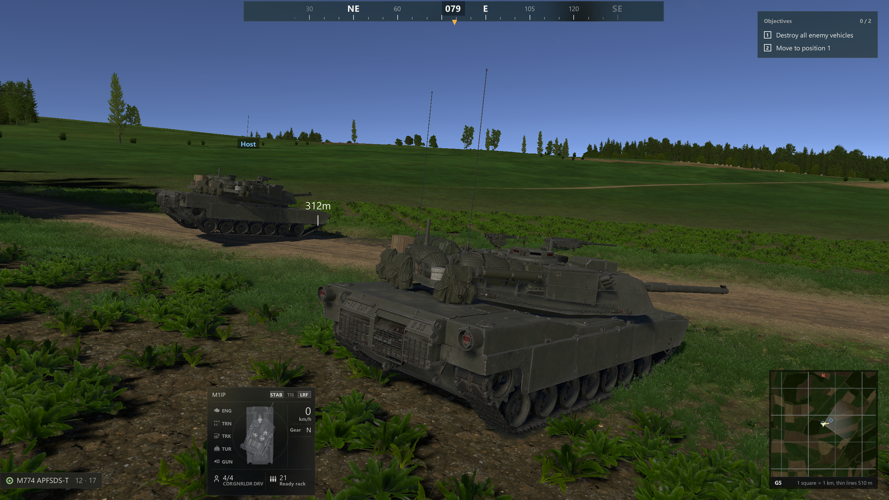
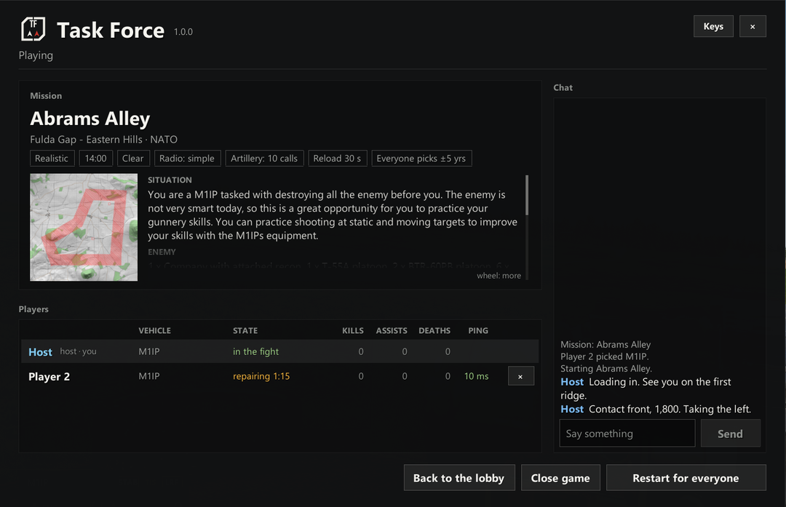
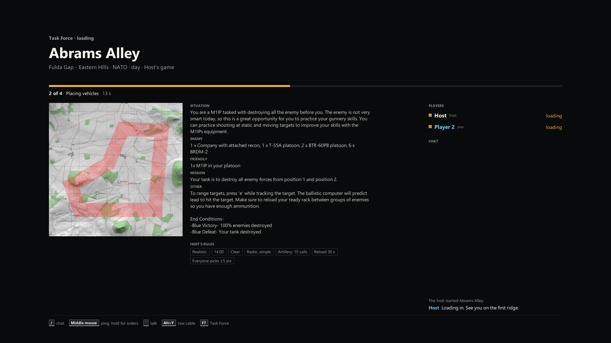

**English** · [Русский](RELEASE_NOTES_1.0.0.ru.md) · [简体中文](RELEASE_NOTES_1.0.0.zh-CN.md)

**1.0.0 - Bring a friend**

F7, Host, six letters to your mate. Two minutes later there are two Abrams on the ridge and one of them isn't the AI.

First public release. If you were in the 0.3 test builds: this is what changed since 0.3.2.

## New

* **Co-op over Steam.** The game's own missions and Phase Line ones, up to 4 players tested. Invite, a six-letter code, or a public list.
* **You always know what the others are doing.** A state for every player in the lobby and in the F7 table, and small pop-ups: in the AAR, back in the lobby, left, lost the connection, back.

  

* **Reconnect.** Lose the connection and the game calls the host back for two minutes. Crash and rejoin, and you're back in the same mission.
* **Mod check that tells you what to do.** If your mods don't match, you get a short list: install this, update that, remove that. The host sees why you couldn't join.

  

* **Phase Line missions send themselves.** The host picks one, everyone gets it in the lobby, with a download bar.
* **New lobby.** Clear READY boxes, one line with the player count, the code and Invite, the mission card with chips for what's set.

  

* **New loading screen.** One bar, who's loaded, the map, the briefing in sections, the host's rules. Chat works on it.

  

* **Restart and Back to the lobby count down** 5 seconds on every PC. Press again to call it off.
* **Deploy an AT team** from a troop carrier in Phase Line missions (Alt+D).
* **Simulator difficulty.** Sights and commander's view only. The free camera is yours again once you're knocked out.
* **Radio sound packs:** Military, Walkie-talkie, Satcom, or off.
* **Vote someone out** from the F7 table. The host's Kick and Close game ask once more first.
* **Knocked out** says who got you and what you can do now, in one place.
* Chat is four rows in the bottom left, with coloured names.
* Direct IP moved under Advanced.
* The Frontline look from Combat Overhaul 2.0.
* A key that another mod already uses is pointed out, with a click to change it.
* Chinese joins English and Russian.

## Bugfixes

* The shared AAR broke from the second session on.
* The lobby list could get stuck on "Looking" for good.
* Cancel on "Joining" didn't cancel.
* One stray file in a mission folder blocked sending a Phase Line mission.
* The host froze for a moment when clicking a big Phase Line mission.
* The mic stayed on if you left during the mic test.
* The time limit and the Simulator rules stopped while F7 was open.
* The fire support count on the planning map didn't match the host's setting.
* Vehicles that co-op spawned (picks, extra tanks, take-overs) had no engine or track sound.
* The game's "Time Scale" and F1 hints showed in co-op, where they do nothing.
* The host no longer trusts a joiner's word on who they are or what they hit.
* Logs are shorter, and player names stay out of `Latest.log`.

## Coming up

* **PvP.** It's greyed out in the lobby for a reason. Coming soon.

**Install:** MelonLoader 0.7.x, `GHPCCoop.dll` into `Bin\Mods`, F7 in the main menu. Everyone needs the same version, and the same gameplay mods as the host.

**Something broke?** `Bin\MelonLoader\Latest.log` and the newest `Bin\UserData\GHPCCoop\logs\coop-....log`, from every player if you can.
