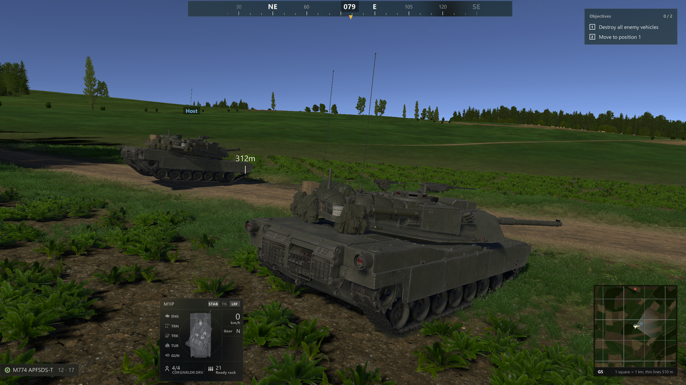
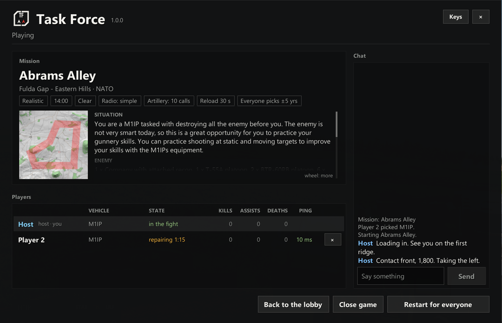
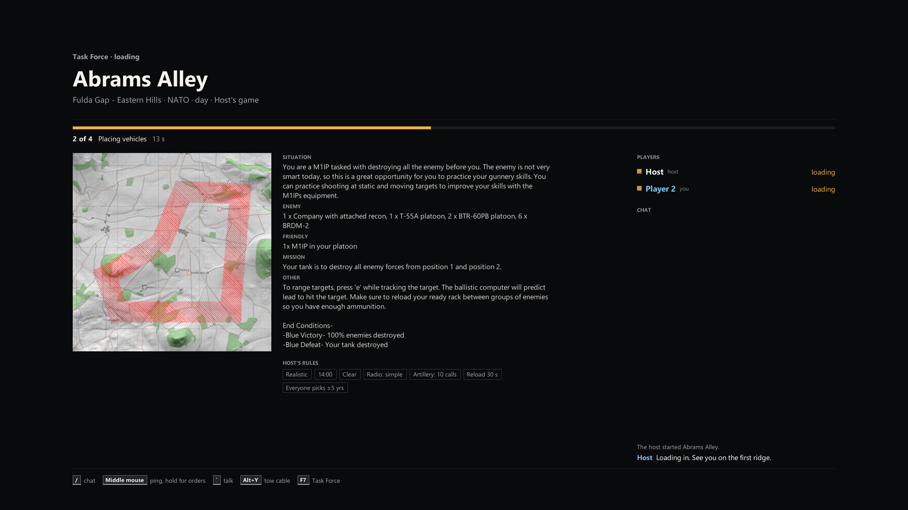

[English](RELEASE_NOTES_1.0.0.md) · **Русский** · [简体中文](RELEASE_NOTES_1.0.0.zh-CN.md)

**1.0.0 - Позови друга**

F7, «Хост», шесть знаков другу. Через две минуты на гребне стоят два Абрамса, и один из них не ИИ.

Первый публичный релиз. Если ты был в тестовых сборках 0.3: вот что изменилось после 0.3.2.

## Новое

* **Кооператив через Steam.** Миссии самой игры и миссии Phase Line, проверено до 4 игроков. Приглашение, код из шести знаков или общий список.
* **Всегда видно, чем заняты остальные.** Статус каждого игрока в лобби и в таблице F7, и короткие всплывашки: в AAR, вернулся в лобби, вышел, потерял связь, вернулся.

  

* **Переподключение.** Потерял связь, и игра две минуты пытается достучаться до хоста. Вылетел и зашёл снова, и ты в той же миссии.
* **Проверка модов, которая говорит, что делать.** Если моды не совпадают, ты получаешь короткий список: поставь это, обнови то, удали вон то. Хост видит, почему ты не смог зайти.

  

* **Миссии Phase Line отправляются сами.** Хост выбирает миссию, все получают её прямо в лобби, с полоской загрузки.
* **Новое лобби.** Понятные поля «Готов», одна строка с числом игроков, кодом и «Пригласить», карточка миссии с чипами того, что выбрано.

  

* **Новый экран загрузки.** Одна полоса, кто уже загрузился, карта, брифинг по разделам, правила хоста. Чат на нём работает.

  

* **Перезапуск и «Назад в лобби» отсчитывают** 5 секунд на каждом ПК. Нажми ещё раз, чтобы отменить.
* **Высадка ПТ-расчёта** из транспорта в миссиях Phase Line (Alt+D).
* **Сложность «Симулятор».** Только прицелы и вид командира. Свободная камера снова твоя, как только тебя подбили.
* **Звуки рации:** «Военные», «Уоки-токи», «Спутник» или «Выкл.».
* **Голосование за кик** из таблицы F7. «Выгнать» и «Закрыть игру» у хоста сначала переспрашивают.
* **«Подбит»** в одном месте говорит, кто тебя подбил и что ты можешь сделать дальше.
* Чат теперь четыре строки внизу слева, с цветными именами.
* Прямой IP переехал в «Дополнительно».
* Вид Frontline из Combat Overhaul 2.0.
* Если клавишу уже занимает другой мод, это видно, и её можно сменить одним кликом.
* К английскому и русскому добавился китайский.

## Исправления

* Общий AAR ломался начиная со второй сессии.
* Список лобби мог навсегда застрять на «Ищем…».
* «Отмена» на «Подключаемся…» ничего не отменяла.
* Один лишний файл в папке миссии не давал отправить миссию Phase Line.
* Хост на мгновение подвисал, когда кликал по большой миссии Phase Line.
* Микрофон оставался включённым, если выйти во время теста микрофона.
* Лимит времени и правила «Симулятора» вставали на паузу, пока открыт F7.
* Число вызовов огневой поддержки на карте планирования не совпадало с настройкой хоста.
* У машин, которые создал кооператив (выбранные, дополнительные танки, пересадки), не было звука двигателя и гусениц.
* Подсказки игры «Time Scale» и F1 показывались в кооперативе, где они ничего не делают.
* Хост больше не верит присоединившемуся на слово, кто он такой и во что попал.
* Логи стали короче, а имён игроков в `Latest.log` больше нет.

## Дальше

* **PvP.** Он серый в лобби не просто так. Скоро.

**Установка:** MelonLoader 0.7.x, `GHPCCoop.dll` в `Bin\Mods`, F7 в главном меню. Всем нужна одна и та же версия и те же геймплейные моды, что у хоста.

**Что-то сломалось?** `Bin\MelonLoader\Latest.log` и самый новый `Bin\UserData\GHPCCoop\logs\coop-....log`, по возможности от каждого игрока.
