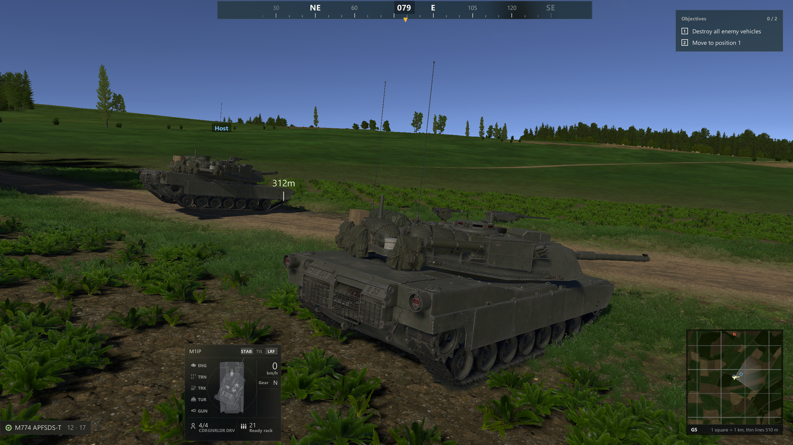
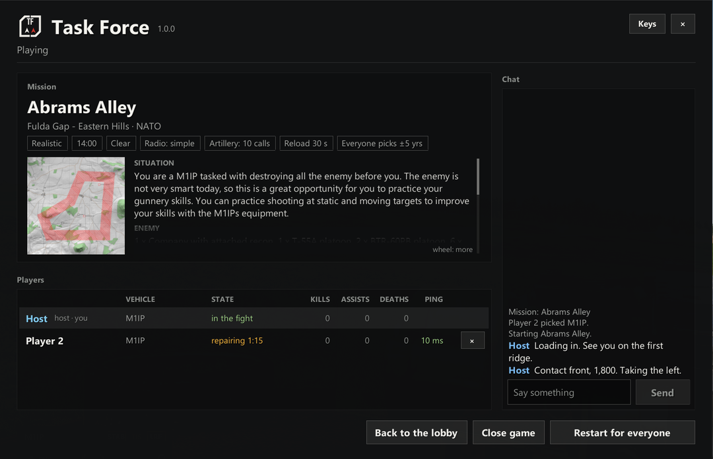
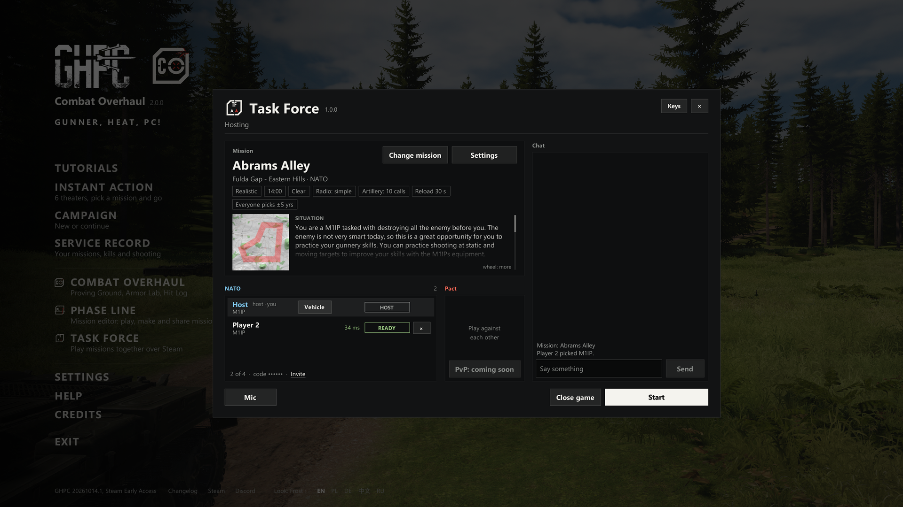
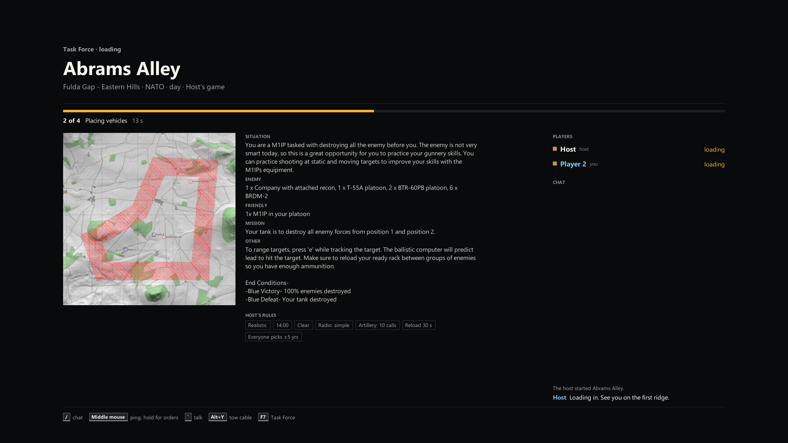

[English](RELEASE_NOTES_1.0.0.md) · [Русский](RELEASE_NOTES_1.0.0.ru.md) · **简体中文**

**1.0.0 - 叫上朋友**

F7，主机，把六位房间码发给你的朋友。两分钟后，山脊上停着两辆艾布拉姆斯，其中一辆不是 AI。

首个公开版本。如果你玩过 0.3 测试版：下面是 0.3.2 之后的变化。

## 新内容

* **通过 Steam 合作。** 游戏自带任务和 Phase Line 任务，测试过最多 4 人。可以用邀请、六位房间码或公开列表加入。
* **随时知道其他人在干什么。** 大厅和 F7 玩家表里有每个玩家的状态，还有小弹窗：进入 AAR、回到大厅、离开、断开连接、回来了。

  

* **重连。** 断线后，游戏会在两分钟内自动重连主机。崩溃后重新加入，你会回到同一个任务。
* **会告诉你怎么做的模组检查。** 模组不一致时，你会看到一份简短清单：装这个、更新那个、删掉那个。主机能看到你为什么没能加入。

  

* **Phase Line 任务自动发送。** 主机选好任务，所有人在大厅里就会收到，还有下载进度条。
* **新大厅。** 清楚的“准备”框，一行显示玩家人数、房间码和“邀请”，任务卡上用标签显示当前设置。

  

* **新加载画面。** 一条进度条、谁已加载完、地图、分段的简报、主机规则。加载时也能聊天。

  

* **重开和返回大厅会倒数** 5 秒，每台电脑上都一样。再按一次就取消。
* **在 Phase Line 任务中从运兵车放下反坦克小组**（Alt+D）。
* **模拟难度。** 只有瞄准镜和车长视角。被击毁后自由视角就回来了。
* **电台音效：** 军用、对讲机、卫星通信，或者关掉。
* **在 F7 玩家表里投票踢人。** 主机的“踢出”和“关闭游戏”会先再确认一次。
* **被击毁** 的提示集中在一处：谁打的你，现在能做什么。
* 聊天改为左下角四行，名字带颜色。
* 直连 IP 移到了“高级”里。
* Combat Overhaul 2.0 的 Frontline 外观。
* 被其他模组占用的按键会标出来，点一下就能改。
* 在英语和俄语之外新增中文。

## 问题修复

* 共享 AAR 从第二局开始就坏掉。
* 大厅列表可能永远卡在“查找中…”。
* “正在加入…”时点取消不起作用。
* 任务文件夹里一个多余的文件会让 Phase Line 任务发不出去。
* 主机点选大型 Phase Line 任务时会卡一下。
* 在麦克风测试中离开，麦克风会一直开着。
* 打开 F7 时，时间限制和模拟难度的规则会停下来。
* 规划地图上的火力支援次数和主机的设置对不上。
* 合作模式生成的载具（自选的、额外的坦克、接管的）没有引擎和履带声。
* 游戏的“Time Scale”和 F1 提示会在合作模式里显示，但在这里根本没用。
* 主机不再轻信加入者自报的身份和命中结果。
* 日志更短了，`Latest.log` 里也不再有玩家名字。

## 即将推出

* **PvP。** 它在大厅里是灰的，这是有原因的。即将推出。

**安装：** MelonLoader 0.7.x，把 `GHPCCoop.dll` 放进 `Bin\Mods`，在主菜单按 F7。所有人的版本必须相同，玩法模组也要和主机一样。

**出问题了？** `Bin\MelonLoader\Latest.log` 和最新的 `Bin\UserData\GHPCCoop\logs\coop-....log`，最好每个玩家都发。
